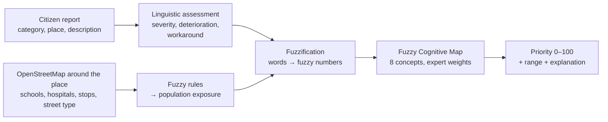

# Project report: prioritising citizen-reported urban problems in Bern

*Seminar of Urban Computing AS2026 — Bill Brandon Chavez Arias, Saadet Yilmaz, Yasmine Alaya*

This report explains **what we built, why each piece is there, what we fixed after the mid-term, and how to answer
the questions we are likely to get**. It stays at the level of concepts; the code itself is in this repository.

---

## 1. The idea in one paragraph

Citizens report problems in the city: a pothole, a broken streetlight, a blocked sidewalk, an overflowing bin.
A city receives many such reports and cannot fix all of them at once, so it needs an **order of priority**.
Our system takes a report, describes it with a few **vague, human-style judgements** ("severity: high",
"there is no way around it"), adds **data about the place** (is there a school nearby? a tram stop? a busy street?),
and runs these through a **Fuzzy Cognitive Map** that reasons about how the factors affect each other. The output is a
**priority score from 0 to 100**, a level (*Very low … Very high*), a plausible range, and an explanation of what
drove the score.

## 2. Why each method

| Piece | Why we use it |
|---|---|
| **Urban computing** | Urban computing uses data generated in the city to improve life in the city. Here citizens act as *sensors* (participatory sensing) and we combine their reports with spatial open data (OpenStreetMap). |
| **Fuzzy logic** | Reports are vague: "a big hole", "it's getting worse". Forcing exact numbers would be fake precision. Fuzzy sets let us use words such as *low / medium / high* and still compute with them. |
| **Fuzzy Cognitive Map (FCM)** | The factors are not independent: a severe defect increases safety risk, safety risk increases the impact on the public, impact increases urgency. A weighted sum cannot represent such chains; an FCM can, and it stays **transparent** (you can see every link and its weight). |
| **Expert elicitation** | Nobody has a dataset that says "severity influences safety with strength 0.67". The standard FCM method is to let experts rate each link in words and combine their answers. |
| **Sensitivity analysis** | Because weights are judgements, we must show the ranking does not collapse if the weights are a bit different. |

## 3. The eight concepts

| Concept | Question it answers | Role |
|---|---|---|
| Severity | How serious is the physical defect? | **Input** (from the report) |
| Deterioration | Is it getting worse? | **Input** (from the report) |
| Population exposure | How many people are exposed? | **Input** (from OpenStreetMap, can be overridden) |
| Workaround availability | Is there a safe alternative? (high = good alternative) | **Input** (from the report) |
| Safety risk | How likely is harm to people? | Computed by the map |
| Service disruption | How much does it interfere with city life? | Computed by the map |
| Residual public impact | Impact that remains after exposure and workarounds | Computed by the map |
| **Response urgency** | How quickly should the city act? | **Output = priority** |

The four inputs are things you can **observe** in a report. The other four are **consequences** that the map
infers. This split is one of the main changes since the mid-term (see section 6).

The causal links are the same as in our mid-term drawing ("Our FCM"), e.g. Severity → Safety risk,
Workaround → Residual impact (negative: a good alternative *reduces* impact), Residual impact → Urgency.

## 4. How a report becomes a priority (worked example)

**Report:** *Blocked sidewalk near a school in Länggasse* (synthetic example).

1. **Words.** Severity = *medium*, Deterioration = *medium*, Workaround = *very low* (no other sidewalk),
   Population exposure = *very high* (kindergarten and school nearby).
2. **Fuzzification.** Each word is a triangle-shaped fuzzy number on 0–1. Its centre of gravity becomes the
   activation: *medium* → 0.50, *very high* → 0.92, *very low* → 0.08.
3. **FCM reasoning.** The four inputs stay fixed. The other concepts start at 0 and are updated again and again:
   each one collects the weighted influence of its causes and passes it through a sigmoid ("squashing") function.
   After about 20 rounds nothing changes any more (the map has *converged*). Here: Safety risk 0.64,
   Service disruption 0.52, Residual impact 0.87, **Response urgency 0.78**.
4. **Result.** Priority **78 / 100 → "Very high"**.
5. **Range.** Words are vague, so we also compute the score with each word read a bit lower and a bit
   higher (the 0.5 α-cut of its fuzzy number): **69–84**.
6. **Explanation.** If exposure were only *medium*, the score would drop by 13 points; if a workaround existed
   (*medium*), it would drop by 4. So this report is urgent mainly **because of where it is**, which is
   exactly the urban-computing point.

Ranking of the six synthetic Bern examples:

| Rank | Report | Score | Range | Level |
|---|---|---|---|---|
| 1 | Water leak, Breitenrain | 82 | 69–87 | Very high |
| 2 | Pothole with no way around, Bolligen | 82 | 71–87 | Very high |
| 3 | Blocked sidewalk near school, Länggasse | 78 | 69–84 | Very high |
| 4 | Overflowing bin, Bundesplatz | 49 | 27–74 | Medium |
| 5 | Broken streetlight, quiet street in Bümpliz | 28 | 16–60 | Low |
| 6 | Overgrown hedge on footpath, Bethlehem | 20 | 16–32 | Very low |

The extreme cases give 88 (everything worst) and 12 (everything best), so the model uses the whole scale.

## 5. Where the weights come from

This is the question we expected most: *"Why is this weight 0.67 and not 0.5?"*

**Answer:** the weights are not typed in as numbers. They are the result of a documented fuzzy procedure:

1. For every arrow in the map, an expert chooses a **word** for its strength: *very weak, weak, moderately weak,
   medium, moderately strong, strong, very strong* (plus the sign + or −).
2. Each word is a **triangular fuzzy number**. Example: *moderately strong* = (0.50, 0.67, 0.83).
3. If several experts answer, their triangles are **averaged**.
4. The averaged triangle is turned into one number with its **centroid** (centre of gravity).
   *Moderately strong* → 0.67.

This is the standard way FCMs are built in the literature (Kosko; Stylios & Groumpos; Papageorgiou).
Right now the file `expert_weights.csv` contains **our team's draft** (one column, with a written reason for every
link). Anyone can add a column (the lecturer, a city engineer, each of us separately); the app and the notebook then
recompute the weights automatically and report how much the experts **disagree** on each link.

What we honestly claim: *"These are transparent, expert-elicited starting weights, and we show the ranking is robust
to changing them."* What we do **not** claim: *"These are the City of Bern's official priorities."*

## 6. What was wrong in the mid-term version and how we fixed it

When testing the first notebook we found a real bug in the reasoning:

- Only two concepts (Exposure, Workaround) were held fixed. Severity and Deterioration have (almost) no arrows
  coming *into* them, so during the iterations they slowly forgot their starting value and ended at the
  **same constant for every report**.
- Result: the priority depended **only on exposure and workaround**. A report with every other input "very high"
  and one with every input "very low" got the **same score (0.63)**.
- Also, Residual impact and Response urgency were given starting values as if they were inputs, although they are
  outputs.

**Fix:**
- The four observable inputs (Severity, Deterioration, Exposure, Workaround) are **clamped** (held fixed).
- The computed concepts start at 0.
- We use the **rescaled Kosko update rule** (Papageorgiou 2011). It keeps each concept's own previous state,
  and it treats 0.5 as "neutral", so low values push down and high values push up.
- Now the worst case gives 0.88 and the best case 0.12.

Being able to explain this is a strength: we tested our own model, found that it ignored its inputs, and fixed it.

## 7. The urban data part: population exposure from OpenStreetMap

When you click a location in the app, it asks OpenStreetMap (through the public Overpass service):

- schools, kindergartens, hospitals and care homes within **120 m**,
- public transport stops within **200 m**,
- the type of street within **30 m** (main road, residential street, pedestrian zone, footpath, …).

Four simple fuzzy rules combine these into a suggested exposure:

- IF vulnerable facilities are near THEN exposure is very high
- IF transit stops are dense THEN exposure is high
- IF the street is busy THEN exposure is high
- IF the street is quiet AND few stops AND no vulnerable facilities THEN exposure is low

Each rule fires to a degree between 0 and 1; the result is the weighted average of the rule outputs
(a *Sugeno-type* fuzzy system). The suggestion is shown with the reasons and can be overridden by hand.
The public server is sometimes overloaded; then the app says so and you set exposure manually.

## 8. Is the ranking robust?

We changed **every** weight at random by up to ±0.10, 300 times, and re-ranked the six reports each time.

- Average rank agreement with the original ranking (Spearman ρ): **0.98** (1 = identical).
- With ±0.20 noise it is still **0.97**.
- The swaps that happen are almost only between rank 1 and 2 (water leak vs. pothole), which are practically tied
  (82.2 vs 82.0). The low-priority reports never jump to the top.

So the conclusions do not depend on the exact decimal values of the weights.

## 9. The interface

Live app: *(link added once deployed)* — or run locally, see `README.md`.

| Tab | What you can do |
|---|---|
| ① New report | Click a place on the Bern map, optionally fetch the OpenStreetMap context, choose the problem type, adjust the words, and see score, range, the factors that drive it, and the FCM graph coloured by activation. Add it to the queue. |
| ② Priority queue | All reports ranked, on a table and a map; run the sensitivity analysis. |
| ③ Model & weights | See the experts' words and the resulting weights; upload a new experts file; try "what if" changes to weights. |
| ④ Method | Short description of the method and references. |

Good demo for the presentation: put the same problem type (e.g. blocked sidewalk) once next to a school and once
on a quiet street, and show how the priority changes only because of the location.

## 10. Limitations (say them before someone else does)

- **Weights** are a team draft until more experts rate them.
- **Example reports are synthetic**, not real Bern cases.
- **No ground truth.** Bern does not publish its reports (they arrive by web form on bern.ch; street lighting goes
  to ewb). Zurich publishes its *Züri wie neu* reports as open data. A next step could compare our category ranking
  with how fast Zurich resolves each category, if that data has closing dates.
- **OpenStreetMap** is good in Bern but not complete; exposure can always be corrected by hand.
- **Possible double counting:** Safety risk influences both Residual impact and Urgency directly. The sensitivity
  analysis shows that this does not change the ranking much.
- The model **supports** triage; safety-critical reports still need a human check.

## 11. Likely questions and short answers

**Why fuzzy and not just numbers?**
Citizens and staff describe problems in words, with vagueness. Fuzzy numbers keep that vagueness and even let us show
it as a range of scores.

**Why an FCM and not a weighted sum or a decision tree?**
Because factors influence each other in chains (severity → safety → impact → urgency). An FCM represents these
causal chains explicitly and stays explainable; a decision tree needs labelled training data we do not have.

**Where do the weights come from?**
From linguistic expert ratings, turned into fuzzy numbers, averaged and defuzzified (section 5). We also show they can
change by ±0.2 without changing the ranking in any important way.

**How is this urban computing?**
Citizens are the sensors, the location is central, and we enrich each report with open spatial data of the city.
The same defect gets a different priority depending on where in Bern it is.

**Why Response urgency as the output and no "Priority" node?**
Urgency already means "how quickly should the city act"; adding another node would just copy it.

**What does "converged" mean?**
The map is updated in rounds; when the values stop changing (change < 0.00001), we take the final values. This takes
about 15–25 rounds.

**What happens if two reports have the same score?**
The range and the explanation help; in practice the staff would look at them. The model gives the order, people decide.

**How would you validate it?**
Collect ratings from more experts (and their disagreement), compare with real resolution times (e.g. Zurich open data),
and ask city staff whether the top of the queue matches their judgement on real cases.

**What did you change after the mid-term?**
We found and fixed the bug where the model ignored severity and deterioration (section 6), built the weight
elicitation procedure, added OpenStreetMap context, the uncertainty range, the sensitivity analysis and the
interactive app.

## 12. Small glossary

- **Fuzzy set / membership:** a set where belonging is a degree between 0 and 1 (a street can be "busy" to degree 0.7).
- **Triangular fuzzy number:** a fuzzy value described by (lowest, most likely, highest).
- **Defuzzification / centroid:** turning a fuzzy number into one crisp number (its centre of gravity).
- **α-cut:** the part of a fuzzy number with membership at least α; we use α = 0.5 for the range.
- **FCM:** a graph of concepts with weighted cause→effect arrows, iterated until stable.
- **Activation:** the current value (0–1) of a concept in the map.
- **Clamped:** held fixed during the iterations.
- **Sigmoid:** an S-shaped function that keeps values between 0 and 1.
- **Spearman ρ:** how similar two rankings are (1 = the same order).

## References

- Kosko, B. (1986). Fuzzy cognitive maps. *International Journal of Man-Machine Studies*, 24, 65–75.
- Stylios, C. D. & Groumpos, P. P. (2004). Modeling complex systems using fuzzy cognitive maps. *IEEE Transactions on
  Systems, Man, and Cybernetics — Part A*, 34(1), 155–162.
- Papageorgiou, E. I. (2011). A new methodology for decisions in medical informatics using fuzzy cognitive maps based
  on fuzzy rule-extraction techniques. *Applied Soft Computing*, 11(1), 500–513.
- Takagi, T. & Sugeno, M. (1985). Fuzzy identification of systems and its applications to modeling and control.
  *IEEE Transactions on Systems, Man, and Cybernetics*, 15(1), 116–132.
- Zheng, Y., Capra, L., Wolfson, O. & Yang, H. (2014). Urban computing: concepts, methodologies, and applications.
  *ACM Transactions on Intelligent Systems and Technology*, 5(3).
- OpenStreetMap contributors, data via the Overpass API (ODbL licence).
- City of Zurich, *Züri wie neu* open data, opendata.swiss.
